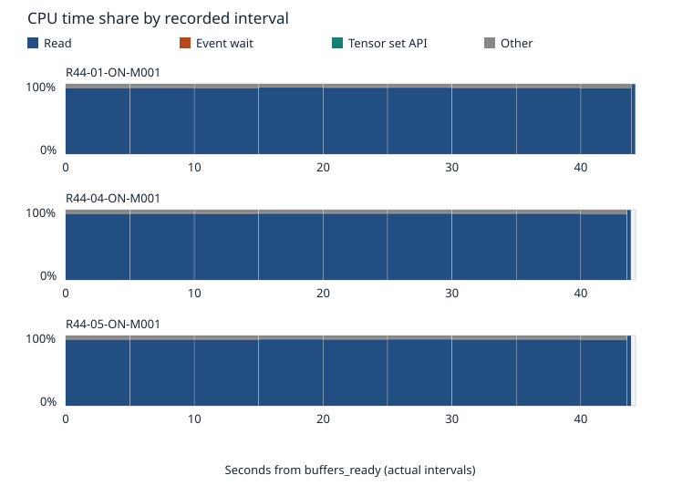

# b12651 系 Vulkan モデルロード診断計測（作業4-4、2026-11-26）

**b12690 の ON／OFF 各3件はすべて正常終了し、容量報告から Context 生成開始報告までの異常な遅延は再現しなかった。** ON の内部計時では Vulkan0 非同期投入の約94%を読み取り呼び出しが占め、staging 再利用イベント待ちは合計約0.30秒だった。初回のネイティブ load time は67.049秒で、差は主に容量→Context の後、PP warmup 報告から本計測開始報告までに現れた。旧異常時の低帯域に対する読み取りとイベント待ちの寄与は引き続き未確定。

## 開始時の環境と実行物

GitHub main の開始時点は `e6431cd29b8b527d6bc5143a5921382373256bd1`。作業4-3の `a1b46e94b` 以後の差分は作業4-1再集計の保全と運用文書。専用 clone の計測ツールは現行製品ブランチ `codex/vulkan-manifest-cpu-variants-20261124` の作業3-5統合版。標準計測の該当パスは main と一致。実験ブランチと worktree は `codex/model-load-diag-20261126` の検証記録 `04b6c1ea3`。実行物のビルド元は `d32cdfaf1c86739b6479260e6324d1394081cf50`（b12690）。 [作業4-1](B12651-MODEL-LOAD-INVESTIGATION-20261126.md) · [作業4-2](B12651-MODEL-LOAD-BASELINE-20261126.md) · [作業4-3の実装とビルド](B12651-MODEL-LOAD-DIAG-20261126.md)

- 実行ディレクトリは `C:\llama-build\automation\w43diag\build-ld\bin\Release`。標準の `Builds.<key>.BinDir` とバイナリ隣接の `evox2-build.json` を使用した。標準計測コードは編集せず、Matrix の `PlanOnly` で ON／OFF とも1セルに展開した。標準 ID 取得は version とデバイス列挙のみ。初回モデルロードは診断 ON。
- 作業4-3のマニフェスト SHA-256 `7fcdef68ba725596a088b1f92811da9414a958b08b67349626c3d82e67ccf14c`、`BuildIdentity=Verified`、EXE SHA-256 `aad7b53f5e67fb83e493611bae9818096efa8b3159748a9ef7c482aa78e1187d`。標準の `Test-Evox2RuntimeArtifacts` は Verified、digest は `dbbedde569242e142fe04f8f6de443920cd86abbb2306e43dfc841ef995473d3`。EXE と `llama.dll`、`llama-common.dll`、`ggml.dll`、`ggml-base.dll`、`ggml-cpu.dll`、`ggml-vulkan.dll` を照合し、Vulkan0 Radeon 8060S と埋め込みソースを確認した。
- 標準マニフェストには `llama-bench-impl.dll`、`ggml-rpc.dll`、`libomp.dll` のハッシュ欄がない。初回後の追加照合で、前2件は作業4-3のリンク記録と Ninja ログの生成物を確認し、現在のハッシュを保存した。ビルド時点の SHA-256 は欠損。libomp は作業4-3の固定済み OpenMP 22.1.8 キャッシュおよび既知の SHA-256 と一致。標準検証はすべての run で有効のまま使用し、2件目以降はこの3件も保存したハッシュと起動前に比較した。

### 実効条件と安全ゲート

Qwen3.8 IQ3 PLE16（81,961,816,672 bytes）、Vulkan0／UMA 96 GiB／Performance。PP8192、TG256、depth 0、独立起動で repetition 1、warmup ON、threads 4、batch 2048、ubatch 1024、GPU layers 999、CPU MoE 0、KV f16、FA ON、MTP OFF。通常2秒、ADLX 2,000 ms、詳細RAM 250 ms。Perf Logger、RGP、作業3-4の高速化変数と IQ2_S A1/A2 は解除した。ON は `LLAMA_MODEL_LOAD_DIAG=1`、OFF は未設定。Matrix がプロセススコープで適用・復元し、各子 `conditions.json` とコントローラー結果で照合した。実引数は子 `output.log` と `conditions.json` に保存した。

Task Manager と競合プロセスがないことを起動前に確認。空きRAM、コミット、GPU、Performance、System／Application の EventRecordID を前後で照合した。前後監査の直近の運用状態は同じ RDP 系セッションの Explorer と DWM を観測。LocalSessionManager の直近再接続記録は11/25 20:53 JST（25、RecordId 3025）。物理・RDP 操作の全履歴は欠損。背景プロセスの CPU 帰属は通常監視の取得範囲に限る。Adrenalin 26.8.1、ROCm 10.0.0 と環境設定は変更なし。

直前に確認できた標準計測ログは同一モデル・Vulkan の R42。R42 終了は11:23:04.885 JST、今回1件目開始は13:39:00.432 JST、差は **2時間15分55.547秒**。標準ログ外の推論終了、最後のモデルロード時刻、完全な OS アイドル期間は確定できない。R42 と同じ OS 起動期間（00:21:08.500 JST）。キャッシュ消去、再起動、アイドル時間の調整は行っていない。

実行物の個別照合結果は [runtime-artifacts.csv](b12651-model-load-diag-results-20261126/runtime-artifacts.csv) に保存した。

## 全 run の順序と結果

ThinkPad から独立した SSH／Matrix を1件ずつ起動し、各終了後に安全確認とログ検証を行った。通常時の比較の順序が片側に偏らないよう、最初の ON を含むペアの後に OFF→ON、最後に ON→OFF を実行した。先行 run は同じモデル・Vulkan。表の「前回終了」は確認できた前回の推論プロセス終了からの差で、実機のアイドル継続時間は別途計測していない。OS 起動は全件で変わらず、起動時刻は Kernel-General/12 と単調稼働時間で確認した。CIM 読み取りは取得できず、高速スタートアップ無効と、過去の予期しない終了後の起動フラグは既存イベントの記録による。

| 順序 | Matrix Run ID | 診断 | PID | 起動 JST | OS稼働 h | 前回終了から s | 起動前 Cache GiB | 容量まで s | 容量→Context s | Context→warmup s | native load s | プロセス s | PP／TG tok/s |
| --- | --- | --- | ---: | ---: | ---: | ---: | ---: | ---: | ---: | ---: | ---: | ---: | ---: |
| 1 | R44-01-ON-M001 | ON | 3300 | 13:39:00.432 | 13.297 | 8,155.547 | 22.344 | 6.709 | 43.960 | 2.085 | 67.049 | 90.353 | 629.610／29.439 |
| 2 | R44-02-OFF-M001 | OFF | 4492 | 13:43:01.761 | 13.364 | 150.976 | 24.138 | 6.183 | 45.474 | 2.100 | 64.371 | 87.188 | 627.644／29.515 |
| 3 | R44-03-OFF-M001 | OFF | 10900 | 13:48:02.576 | 13.447 | 213.627 | 24.233 | 6.192 | 44.471 | 2.091 | 63.720 | 86.512 | 627.096／29.542 |
| 4 | R44-04-ON-M001 | ON | 16984 | 13:51:41.125 | 13.508 | 132.037 | 24.250 | 6.211 | 43.954 | 2.093 | 63.182 | 85.979 | 626.976／29.530 |
| 5 | R44-05-ON-M001 | ON | 6264 | 13:55:20.121 | 13.569 | 133.017 | 24.275 | 6.175 | 43.965 | 2.114 | 63.229 | 86.035 | 626.296／29.536 |
| 6 | R44-06-OFF-M001 | OFF | 10356 | 13:58:55.449 | 13.629 | 129.293 | 24.210 | 6.198 | 43.989 | 2.102 | 63.194 | 86.005 | 626.585／29.513 |

全件で容量報告から Context 報告までの間隔は旧正常対照と同程度だった。初回ONの warmup 報告→PP 実測開始報告は14.702秒、以降は11.139～11.161秒。初回 PP の最初の Graph reserve（226.38 ms）は以降の231.26～239.75 msに比べて増えていなかった。この差をモデルデータ投入中の低速化として集計しない。受信時刻の差から PP warmup 内の個別関数や原因は特定できない。 [run 集計](b12651-model-load-diag-results-20261126/runs.csv)

## 診断出力と計時境界

stderr の固定 prefix `llama_load_diag ` を抽出し、JSON schema 1 を検証した。ON では `load_tensors_begin`、`mappings_begin/end`、`buffers_ready`、各群の `group_begin/phase/progress/end`、`postprocess_begin`、`load_tensors_end` が実装順。群番号は処理順で、各群の終了状態は `ok`。累積回数・バイト数・時間の単調性、ヒストグラムの件数と最大値、長時間記録件数・位置、`wall_us = classified_us + unclassified_us` を照合した。OFF は prefix 0件。両モードの既存 stdout JSON は PP／TG の2行で各 `samples_ns` は1件。PP/TG は Matrix と一致した。

- 容量／Context／warmup はラッパーが stderr を受信した時刻。プロセス開始は OS UTC。ネイティブ load は最初の eval 同期まで含まれ得るため、差分の意味は容量→Context と異なる。PP/TG は個別の bench 実測ループ。 [初回同期での更新](https://github.com/ariera-j/llama.cpp-evox2-windows/blob/d32cdfaf1c86739b6479260e6324d1394081cf50/src/llama-context.cpp#L949-L980) · [作業4-1のタイマー整理](B12651-MODEL-LOAD-INVESTIGATION-20261126.md)
- 診断の積算はローダーのスレッド上の重複しない CPU 側経過時間。read は要求バイト数と Windows API を含む読み取り処理の経過時間を記録する。upload は論理転送バイト数と非同期テンソル設定 API 内の時間。GPU 上の実転送時間や SSD 実転送量は直接測っていない。同じ staging slot の再利用では `event_synchronize` の完了後に read を開始する。読み取り呼び出しの時間増大とイベント待ちによる次の読み取り開始の遅れは、ともに総読み取りレートを下げ得る。 [アップロード順と計時](https://github.com/ariera-j/llama.cpp-evox2-windows/blob/d32cdfaf1c86739b6479260e6324d1394081cf50/src/llama-model-loader.cpp#L1915-L1985) · [Windows ファイル処理](https://github.com/ariera-j/llama.cpp-evox2-windows/blob/d32cdfaf1c86739b6479260e6324d1394081cf50/src/llama-mmap.cpp#L210-L278)
- 進捗の `active` はその群で現在処理中または直近に処理したテンソルの通番・shard・テンソル先頭。進捗時点のチャンク位置は特定できない。長時間記録には個別の処理位置があり、`reuse_wait` と `drain` はその slot に登録済みの upload の位置を参照する。進捗は操作の完了時に出る。長い呼び出しの最中はログから進行を確認できない。 [テンソルと位置](https://github.com/ariera-j/llama.cpp-evox2-windows/blob/d32cdfaf1c86739b6479260e6324d1394081cf50/src/llama-model-loader.cpp#L1841-L1865) · [drain と解放](https://github.com/ariera-j/llama.cpp-evox2-windows/blob/d32cdfaf1c86739b6479260e6324d1394081cf50/src/llama-model-loader.cpp#L2040-L2055) · [進捗と最長記録](https://github.com/ariera-j/llama.cpp-evox2-windows/blob/d32cdfaf1c86739b6479260e6324d1394081cf50/src/llama-model-load-diag.h#L170-L244)
- RAM 詳細は UTC と単調 tick 順、通常監視は UTC と指標別の取得時刻、ADLX は JST から UTC に換算。診断単調時刻は `buffers_ready` と最後の容量報告の受信時刻をアンカーにした概算。行時刻、PDH の集計窓、250 ms の詳細RAM採取、ラッパーの受信遅延が異なる。診断と他ログの時刻の近さから処理の厳密な同時性は判定できない。 [容量直後から後処理まで](https://github.com/ariera-j/llama.cpp-evox2-windows/blob/d32cdfaf1c86739b6479260e6324d1394081cf50/src/llama-model.cpp#L2234-L2290)

## 群・操作別の内部所要時間

モデルのログは `load_mode=none`。ON 3件の順序は第1群 Vulkan0（非同期 upload、1,238テンソル、read 要求と論理 upload は各81,429,319,260 bytes）、第2群 Vulkan_Host（直接 host read、1テンソル、521,472,000 bytes、GPU論理転送0）。容量報告は77,657.05／497.31 MiB。同期転送 fallback と mmap／lazy の計数は観測されなかった。 [群 CSV](b12651-model-load-diag-results-20261126/groups.csv) · [時刻・phase CSV](b12651-model-load-diag-results-20261126/boundaries.csv)

| 順序 | GPU群 wall s | 分類済み s | 残差 s | Vulkan_Host s | buffers_readyから終了 s | 後処理 s | 容量アンカーでの終了−Context s |
| --- | ---: | ---: | ---: | ---: | ---: | ---: | ---: |
| 01 | 43.936137 | 43.907442 | 0.028695 | 0.314660 | 44.251619 | 0.000249 | 0.291 |
| 04 | 43.589816 | 43.560467 | 0.029349 | 0.317851 | 43.908241 | 0.000070 | -0.045 |
| 05 | 43.605461 | 43.576194 | 0.029267 | 0.317979 | 43.923962 | 0.000068 | -0.042 |

次の範囲は正常 ON 3件。CPU 側の待ちと API 経過時間を示す。操作別の全件、群ごとの非分類時間、10区間のヒストグラムは派生 CSV に保存した。 [操作 CSV](b12651-model-load-diag-results-20261126/operations.csv) · [長時間記録 CSV](b12651-model-load-diag-results-20261126/waits.csv)

| 群 | 操作 | 回数 | bytes | 累積 s | 平均 µs | 最大 ms |
| --- | --- | ---: | ---: | ---: | ---: | ---: |
| 1 | `staging_alloc` | 4 | 4,194,304 | 0.001362～0.001843 | 340.500～460.750 | 0.383～0.606 |
| 1 | `event_create` | 4 | 0 | 0.000044～0.000072 | 11.000～18.000 | 0.024～0.032 |
| 1 | `backend_init` | 1 | 0 | 0.000026～0.000032 | 26.000～32.000 | 0.026～0.032 |
| 1 | `seek` | 1,238 | 0 | 0.000470～0.000473 | 0.380～0.382 | 0.003～0.010 |
| 1 | `read` | 78,516 | 81,429,319,260 | 41.075379～41.416599 | 523.147～527.492 | 20.357～23.158 |
| 1 | `first_wait` | 4 | 0 | 0.000003～0.000005 | 0.750～1.250 | 0.002～0.003 |
| 1 | `reuse_wait` | 78,512 | 0 | 0.295613～0.299153 | 3.765～3.810 | 0.169～0.338 |
| 1 | `upload` | 78,516 | 81,429,319,260 | 0.173911～0.178266 | 2.215～2.270 | 0.808～1.676 |
| 1 | `event_record` | 78,516 | 0 | 1.971619～1.987662 | 25.111～25.315 | 0.460～0.514 |
| 1 | `drain` | 4 | 0 | 0.000010～0.000012 | 2.500～3.000 | 0.004～0.005 |
| 1 | `event_free` | 4 | 0 | 0.000047～0.000050 | 11.750～12.500 | 0.029～0.031 |
| 1 | `staging_free` | 4 | 0 | 0.000774～0.001003 | 193.500～250.750 | 0.240～0.337 |
| 1 | `backend_free` | 1 | 0 | 0.010806～0.011918 | 10,806.000～11,918.000 | 10.806～11.918 |
| 1 | `callback` | 1,238 | 0 | 0.016939～0.018201 | 13.683～14.702 | 0.328～0.660 |
| 2 | `seek` | 1 | 0 | 0.000001 | 1.000 | 0.001 |
| 2 | `host_read` | 1 | 521,472,000 | 0.313831～0.317264 | 313,831.000～317,264.000 | 313.831～317.264 |
| 2 | `backend_free` | 1 | 0 | 0.000000～0.000001 | 0.000～1.000 | 0.000～0.001 |
| 2 | `callback` | 2 | 0 | 0.000134～0.000162 | 67.000～81.000 | 0.133～0.162 |

GPU 群の read は各78,516回で、10～20 ms が15～18回、20～50 ms が各1回、50 ms以上はゼロ。reuse_wait は各78,512回で、0.1～1 ms が21～33回、1 ms以上はゼロ。event_record の1回当たりは約25 µs、積算は1.972～1.988秒。多数回の小さい呼び出しが積み上がる規模の正常対照を得た。GPU 群で100 ms以上の記録は0件。第2群では各1件の host_read（313.831～317.264 ms）が長時間記録の全件で、shard 0、絶対ファイル位置29,339,631,712、テンソル内位置0、staging slotなし。既存メタデータとの照合で `token_embd.weight` に対応した。

### 進捗区間と処理位置

下図は個々の実測区間の wall time に占める read／host_read、先頭・再利用イベント待ち、テンソル設定 API、その他（event_record、セットアップ・解放などと未分類分）の割合。横軸は `buffers_ready` からの診断単調時間。群末の短い残区間も表示する。進捗の累積値の差で、要求バイトと論理バイト、回数、時間を計算した。最初の区間で読み取りと upload の進捗量がわずかに違う場合は、操作完了で進捗を出す境界が異なるため。 [進捗 CSV](b12651-model-load-diag-results-20261126/progress.csv)

群内テンソル通番を GGUF の列順に読み替えることはできない。実行時は非 mmap の device テンソルをサイズの大きい順に安定ソートする。shard 0 のテンソル先頭絶対オフセットを、同一 IQ3 PLE16 の既存ヘッダー台帳に照合した。全1,239件、payload 81,950,791,260 bytes が一致した。 [テンソルの並べ替え](https://github.com/ariera-j/llama.cpp-evox2-windows/blob/d32cdfaf1c86739b6479260e6324d1394081cf50/src/llama-model-loader.cpp#L1804-L1842) · [GGUF ヘッダー集計](../pr30904-preport-20261125/README.md)

第1群の進捗8区間／run は各5.000～5.003秒。読み取り要求量は1,701～1,947 MiB/s、read の wall 比93.67～94.77%、イベント待ち0.64～0.73%、upload API 0.35～0.49%。群末の残り区間でも1,574～1,629 MiB/s。初回と4・5件目の最後の定期進捗は起動後46.18～46.72秒付近で、累積要求74.72～75.51 GB、論理転送74.72～75.51 GB、完了148／151／151テンソル。active は群1の149番 `blk.41.ffn_up_exps.weight`（shard 0、先頭75,181,653,728）または152番 `blk.43.ffn_gate_exps.weight`（shard 0、先頭77,076,270,048）。この位置は正常時末尾の観測で、過去の低速化開始位置は未取得。

### リソース時系列の照合

前半はプロセス起動後7～45秒、末尾は Context 報告直前14秒の有効データ。通常監視と ADLX の値は区間内の取得点の中央値で、RAM ピークは詳細RAMの単一観測点。前後監視を含む詳細RAMの行数と平均間隔を示す。指標の欠損は空欄。GPU メモリの WDDM／ADLX 値は RAM や commit に加算しない。 [詳細RAM抜粋](b12651-model-load-diag-results-20261126/ram_selected.csv) · [通常監視](b12651-model-load-diag-results-20261126/resources.csv) · [ADLX](b12651-model-load-diag-results-20261126/adlx.csv)

| 順序 | RAM行／平均間隔 ms | 空き最小 GiB | Commit最大 GiB | RAMピーク起動後 s | ピーク→Context s | ピーク Cache／WS／Private GiB | Disk 前半／末尾 MiB/s | 末尾 Pages Input/s | 末尾 ADLX GPU % |
| --- | ---: | ---: | ---: | ---: | ---: | ---: | ---: | ---: | ---: |
| 01 | 388／254.4 | 23.289 | 90.747 | 50.337 | 0.332 | 24.000／0.648／77.472 | 1,756.3／1,589.8 | 406,864 | 13.0 |
| 02 | 376／253.8 | 23.368 | 90.584 | 50.366 | 1.291 | 24.240／0.641／77.469 | 1,758.9／1,648.6 | 422,040 | 8.0 |
| 03 | 373／254.1 | 23.378 | 90.564 | 50.347 | 0.316 | 24.054／0.626／77.454 | 1,794.3／1,556.6 | 398,236 | 12.0 |
| 04 | 372／253.5 | 23.285 | 90.548 | 49.787 | 0.377 | 23.982／0.626／77.454 | 1,792.3／1,578.8 | 404,417 | 11.0 |
| 05 | 371／254.3 | 23.364 | 90.611 | 49.144 | 0.997 | 24.243／0.641／77.469 | 1,806.9／1,606.9 | 411,621 | 12.0 |
| 06 | 371／253.9 | 23.356 | 90.571 | 49.128 | 1.059 | 24.250／0.641／77.469 | 1,794.7／1,601.6 | 410,786 | 13.0 |

通常監視は PID GPU カウンターの一部欠損と SSH からの背景 CPU 読み取り制限により Partial。システムのディスク・ページ入力・CPU、ネイティブ／対象メモリの通常行は取得でき、詳細RAMのネイティブ欠損は全件ゼロ。ADLX は全件 Complete。Defender／Indexer 等のプロセス名は取得できたが、個々の活動量は不明。詳細RAMでは初回の System Cache が22 GiB台から24 GiB付近へ増え、後続の開始前は24 GiB台。投入中の Private は約77.47 GiB、WS は約0.63–0.65 GiB。Context 後に Private・コミットが次の水準へ増え、対象の WDDM 専用／共有の末尾中央値は全件76.892／0.491 GiB。空きRAMは23 GiB台で推移した。

ON 3件の RAM ピークは容量アンカー上で第1群終了の0.014～0.637秒前に位置した。初回の推定モデル終了は Context 受信より0.291秒後に来る。内部の実行順とのずれであり、時刻合わせの精度がサブ秒単位で限られる一例。モデル終了を Context 受信に仮に重ねると、第1群終了はピークの約0.017～0.678秒後になる。正常時はいずれも GPU 群末付近と整合するが、同じ peak が drain、staging 解放、ホスト群切替のどの処理で生じたかは切り分けられない。

## 既存の異常ロードとの比較

旧 b12676 の正常対照では容量報告から Context 生成開始報告まで44.466～45.522秒。異常時の M001 は167.499秒、R34R3D-M001 は59.663秒、R42 は104.515秒。R34R3D と R42 の前半は新計測と同水準で、Context 前14秒の中央値は Disk Read 58／60 MiB/s、Pages Input 14,757／15,384 pages/s、ADLX GPU 1%だった。PP/TG は正常範囲。旧異常 run の読み取り、イベント待ち、転送、drain の個々のタイマーは欠損。実行バイナリも異なるため、新しい正常内部値を旧計測の遅延へ直接割り振ることはできない。 [旧 run の同一条件比較](B12651-MODEL-LOAD-BASELINE-20261126.md)

RAM 使用量ピークから Context 報告までの旧 R34R3D の8.555秒と R42 の8.558秒は、関連する処理段階の仮説を立てる材料。旧 run には `buffers_ready` 単調時刻と群・個別処理計時がなく、過去のピークを drain、staging 解放、ホスト読み込みに対応付けることはできない。ページ入力のシステム集約値はモデルファイル、ファイルキャッシュ、他のページ読み込みを識別しない。GPU メモリの量が横ばいであることだけでは residency や転送中の待ちの有無を判断できない。 [作業4-1の切り分け](B12651-MODEL-LOAD-INVESTIGATION-20261126.md)

## 原因の判断と次の調査候補

正常時の Vulkan0 非同期投入の大半はローダー側の読み取り呼び出し時間で、ホスト群は小さい。異常時に増えた処理の種類とデータ位置を確かめるには、異常時の内部診断との比較が必要。読み取り API とイベント再利用待ちを同じ優先度で扱う。低帯域の観測だけでは、OS／ストレージ側の読み取り停滞と、次の読み取り開始を待たされた結果を識別できない。ROCm の物理 RAM 逼迫、IQ2_S の初回 eval 遅延、M005 のハードフリーズは独立した観測として扱う。

次の調査で追加計測が承認された場合は、自然な計測再開時の最初のロードを同一 b12690 の診断 ON にする。今回すでに正常な内部対照があるため、異常を捕捉できたら同じ群・経路・データ量で比較し、追加時間を read、reuse_wait、upload、event_record、drain、その他に分ける。読み取り API 内の時間が増えた場合の特定には、ファイル別 I/O・キャッシュの記録が必要。イベント待ちが増えた場合は GPU 側のイベント・スケジューリングを対象に絞れる。OS トレースや GPU 診断は内部計時で対象が絞れた場合に別途判断する。前回終了・同じモデルの前回ロード・バックグラウンドの記録は分かる範囲で継続し、初回傾向を判断するには独立した計測セッションが必要。

## 同じ b12690 の正常 ON／OFF

| 指標 | ON 3件の範囲 | OFF 3件の範囲 | 中央値差 ON−OFF |
| --- | ---: | ---: | ---: |
| 容量→Context s | 43.954～43.965 | 43.989～45.474 | -0.510 |
| ネイティブ load s | 63.182～67.049 | 63.194～64.371 | -0.491 |
| プロセス s | 85.979～90.353 | 86.005～87.188 | -0.477 |
| PP tok/s | 626.296～629.610 | 626.585～627.644 | -0.120 |
| TG tok/s | 29.439～29.536 | 29.513～29.542 | +0.016 |
| 最小空きRAM GiB | 23.285～23.364 | 23.356～23.378 | -0.078 |
| 最大コミット GiB | 90.548～90.747 | 90.564～90.584 | +0.040 |
| 最大 Working Set GiB | 0.678～0.777 | 0.678～0.679 | +0.000 |
| 最大 Private GiB | 80.062～80.176 | 80.058～80.058 | +0.005 |
| 前半 CPU 中央値 % | 4.7～5.8 | 4.7～5.4 | -0.1 |
| 末尾 CPU 中央値 % | 4.5～6.7 | 4.6～8.4 | -0.4 |
| Disk Read 前半中央値 MiB/s | 1,756.3～1,806.9 | 1,758.9～1,794.7 | -2.0 |
| Disk Read 末尾中央値 MiB/s | 1,578.8～1,606.9 | 1,556.6～1,648.6 | -11.8 |
| stderr bytes | 757,214～757,238 | 737,200 | +20,037 |

正常6件の観測では容量→Context の診断 ON に遅延の上乗せは見えなかった。起動順、System Cache、初回 warmup の差が残るため、この時間差を診断の因果効果や負荷の上限には用いない。ログ量の直接の追加は1件あたり19,968～19,992 bytes。PP/TG および ADLX クロックは下表の実測範囲。クロックは bench の実測窓に入った稼働率90%以上の点の単純平均。

| 順序 | PP GPU／VRAM MHz（点） | TG GPU／VRAM MHz（点） | 通常／ADLX行 | stderr bytes | 診断件数／bytes |
| --- | ---: | ---: | ---: | ---: | ---: |
| 01 | 2,883.0／969.7 (6) | 2,860.5／999.8 (4) | 37／50 | 757,214 | 23／19,968 |
| 02 | 2,873.9／966.9 (7) | 2,893.7／999.7 (3) | 35／48 | 737,200 | 0／0 |
| 03 | 2,874.0／964.0 (6) | 2,896.7／999.7 (3) | 35／48 | 737,200 | 0／0 |
| 04 | 2,875.2／967.2 (6) | 2,888.2／999.2 (4) | 34／48 | 757,237 | 23／19,991 |
| 05 | 2,867.3／968.2 (6) | 2,887.8／999.0 (4) | 35／48 | 757,238 | 23／19,992 |
| 06 | 2,867.0／967.7 (6) | 2,889.2／999.2 (4) | 34／47 | 737,200 | 0／0 |

## 原本・派生データと安全確認

生ログのルートは `C:\llama-build\_logs\codex`。下表の子ディレクトリに stdout／stderr、条件、結果 JSON、通常／ADLX／詳細RAMの CSV、ラッパーの受信時刻がある。Matrix の下位ディレクトリに計画、実行条件、安全確認と比較 CSV がある。 `r44-model-load-20261126` に起動制御、ON／OFF 用の一時プラン、前後ゲートの結果と transcript を保存した。GitHub main にはこの報告と解析スクリプト、再現手順、派生 CSV、図を収録する。 [再集計方法](b12651-model-load-diag-results-20261126/README.md) · [入力データの SHA-256](b12651-model-load-diag-results-20261126/input_hashes.csv)

| 順序 | 子ディレクトリ | Matrix の下位ディレクトリ | 空きRAM 前→後 GiB | commit 前→後 GiB |
| --- | --- | --- | ---: | ---: |
| 1 | `20261126-133848-236-bench-vulkan-b12690-ctx8192-bd810f7bbb71` | `20261126-133805-551-b12651-monitor-overhead` | 25.540→25.441 | 9.589→9.629 |
| 2 | `20261126-134249-498-bench-vulkan-b12690-ctx8192-318ed9714048` | `20261126-134206-921-b12651-monitor-overhead` | 25.514→25.444 | 9.559→9.632 |
| 3 | `20261126-134750-395-bench-vulkan-b12690-ctx8192-318ed9714048` | `20261126-134707-796-b12651-monitor-overhead` | 25.522→25.436 | 9.559→9.638 |
| 4 | `20261126-135128-925-bench-vulkan-b12690-ctx8192-bd810f7bbb71` | `20261126-135046-335-b12651-monitor-overhead` | 25.513→25.436 | 9.567→9.625 |
| 5 | `20261126-135507-939-bench-vulkan-b12690-ctx8192-bd810f7bbb71` | `20261126-135425-371-b12651-monitor-overhead` | 25.507→25.418 | 9.564→9.647 |
| 6 | `20261126-135843-278-bench-vulkan-b12690-ctx8192-318ed9714048` | `20261126-135800-685-b12651-monitor-overhead` | 25.511→25.427 | 9.570→9.639 |

各 run で Task Manager の不在、Performance、子の終了コード0、Matrix OK、RAM／GPU 回復 WithinTolerance、競合・残留プロセスなし、診断フラグ復元、SSH正常終了を確認。WDDM 戻り値は前後約0.484 GiB。System の RecordId 69629、Application 43769 は全件の確認範囲で変わらず、GPU 異常や重大イベントの新規記録はなかった。3件目の起動操作は最初の PowerShell がスクリプト実行ポリシーで停止し、モデルは起動していない。運用手順のプロセス限りの `RemoteSigned` を付けて実行し、子プロセスは1件だった。

終了時点の EVO-X2 専用 clone は `codex/vulkan-manifest-cpu-variants-20261124` の `f500e9b070f3e6065dde50309def74d83cf9ddd4`、診断 worktree は `codex/model-load-diag-20261126` の `04b6c1ea3d92f9c48800805cf853004d1ec0ff88`。どちらも対応する追跡先と一致（ahead 0／behind 0）し、作業ツリーは clean。製品、標準ツール、診断ソース、ビルド、環境設定への変更はない。実機の origin/main は計測終了時に `e6431cd29b8b527d6bc5143a5921382373256bd1`。GitHub main の更新はこの文書、索引と関連する解析資料のみ。計測は上限の6件で終了した。
